# Sentinel SOC: UI test report

Date: 2026-10-06. Environment: laptop dashboard at `http://127.0.0.1:8000`, Android app 0.1.5 on a physical phone (USB tunnel via `scripts/usb-tunnel-watch.ps1`). Samples on the dashboard: **Duo Mobile** (safe), **Sentinel FIXTURE** (malicious test APK), **HappyMod** (suspicious).

Every screenshot below was captured during the run; none are mock-ups.

## Results

| # | Test case | Result |
|---|---|---|
| 1 | Recent scans list shows safe, malicious and suspicious | PASS |
| 2 | Verdict display of a malicious file | PASS |
| 3 | YARA and Sigma rules of a malicious file | PASS |
| 4 | Analysis page of a malicious APK | PASS |
| 5.1 | Override the verdict from the laptop | PASS |
| 5.2 | Override notification appears on the phone | PASS |

---

## TC1: Recent scans list (safe, malicious, suspicious)

**Steps:** open the Submissions page and read the list.

**Expected:** three rows, each with a verdict chip (icon and text), a confidence, and a status.

**Actual:** HappyMod shows **SUSPICIOUS 95%**, Sentinel FIXTURE shows **MALICIOUS 95%**, and Duo Mobile shows **SAFE 70%**. All are DONE and run by device I2302.

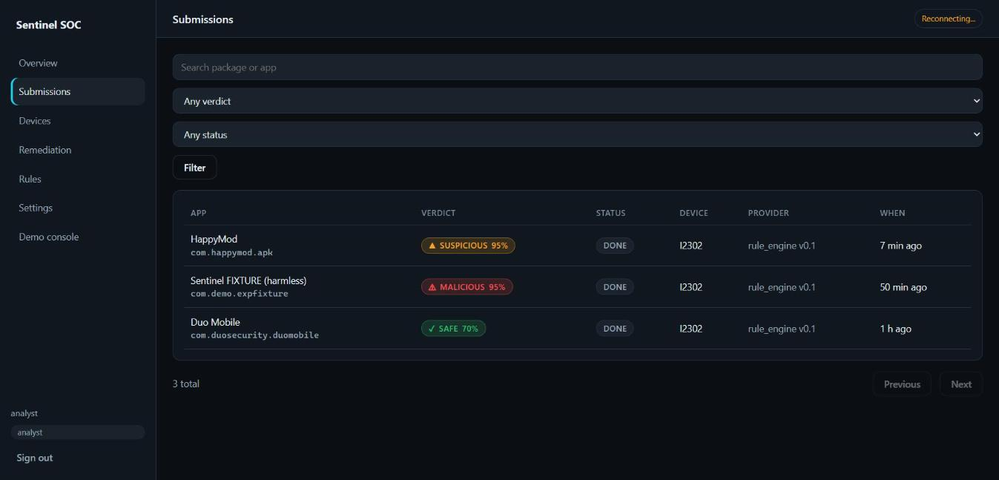

**Result: PASS**

---

## TC2: Verdict display of the malicious file

**Steps:** open the Sentinel FIXTURE submission.

**Expected:** a MALICIOUS chip, the explanation, the top signals and the recommended action.

**Actual:** the header shows **MALICIOUS 95%**. The summary gives the risk score (1.00 from 8 signals), the key findings (SMS access, shell commands, debuggable build), the recommended action *uninstall*, and the ATT&CK tags T1636 and T1417.

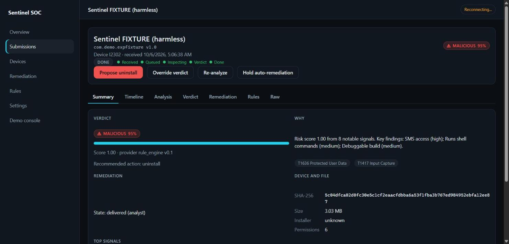

**Result: PASS**

---

## TC3: YARA and Sigma rules of the malicious file

**Steps:** on the fixture submission, open the **Rules** tab and press **Generate rules**. Then open each rule.

**Expected:** three drafts (two Sigma, one YARA), each with its content and FP-test status.

**Actual:** the Rules tab lists 3 generated rules, all draft, FP test `not_run`. The YARA rule matches the DEX magic and the beacon URL and class names, with the condition `uint32(0) == 0x0a786564 and (any of ($net*) or 2 of ($cls*))`. The hash Sigma rule matches the file's SHA-256.

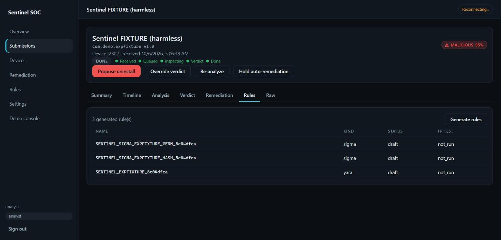
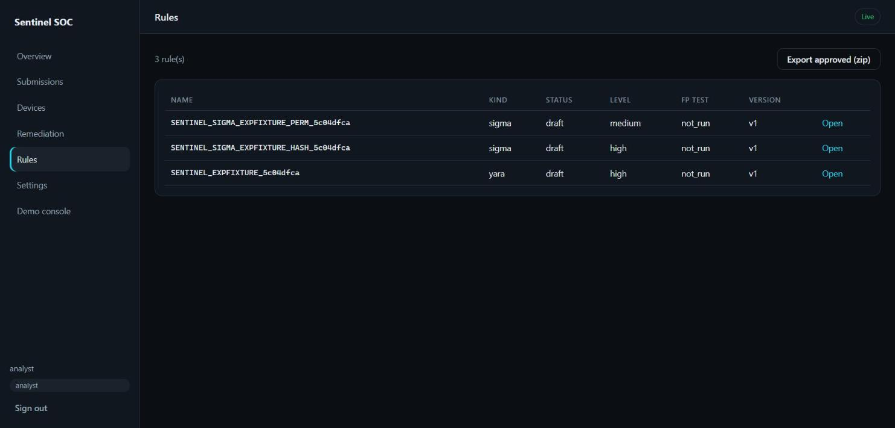
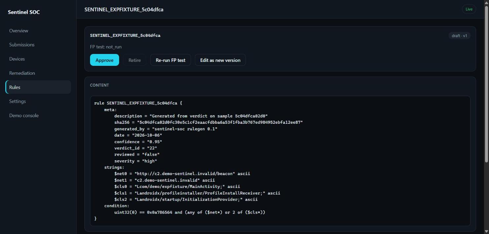
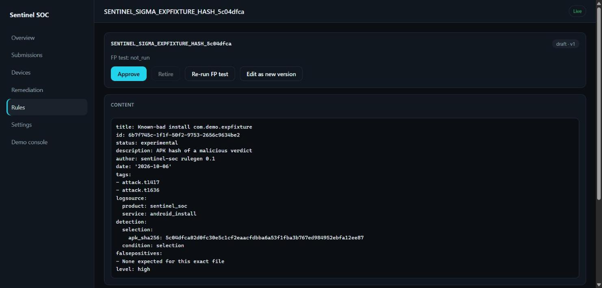

**Result: PASS**

**Note:** the first attempt showed "0 generated rule". The page still held data from before the generation. Reloading the page showed the three rules. The server had created them.

---

## TC4: Analysis page of the malicious APK

**Steps:** on the fixture submission, open the **Analysis** tab.

**Expected:** the list of signals, each with an ID, severity, name, detail and ATT&CK mapping.

**Actual:** 8 signals are listed, from `sig_1` (high, SMS access, T1636) down through medium signals such as shell commands, debuggable build, draw-over-apps (T1417), package installs and the hard-coded beacon URL.

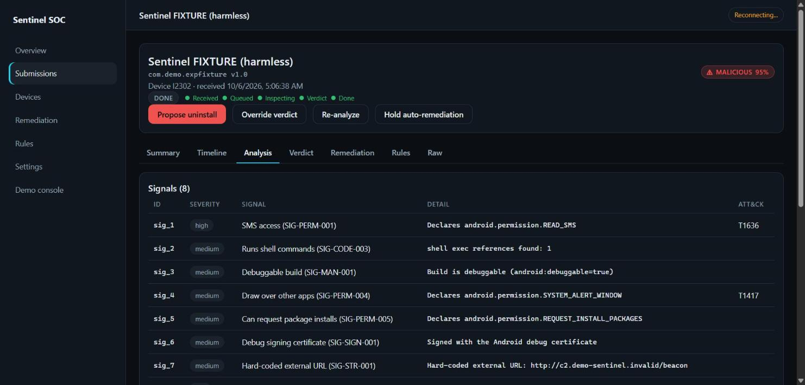

**Result: PASS**

---

## TC5: Override flow

### TC5.1: Override from the laptop

**Steps:** on the fixture submission, press **Override verdict**, pick **Suspicious**, type a reason, keep **Notify the device** checked, and press **Save override**.

**Expected:** the dialog asks for the verdict and a reason. After saving, the header shows the new verdict with an *Analyst override* tag.

**Actual:** the dialog opens with the current verdict, the reason is typed, and after saving the header shows **SUSPICIOUS 95%** with the **ANALYST OVERRIDE** tag.

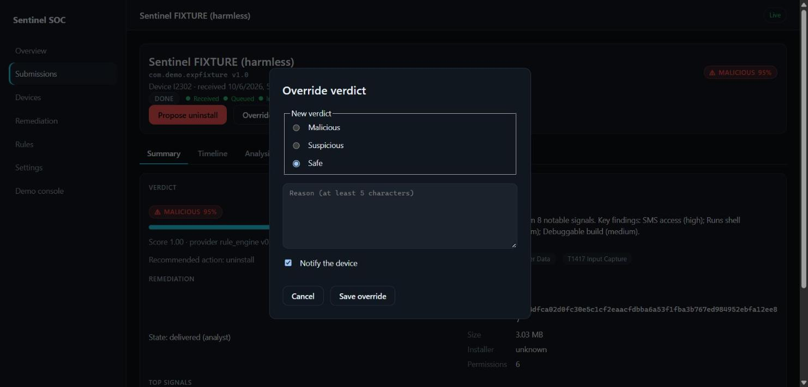
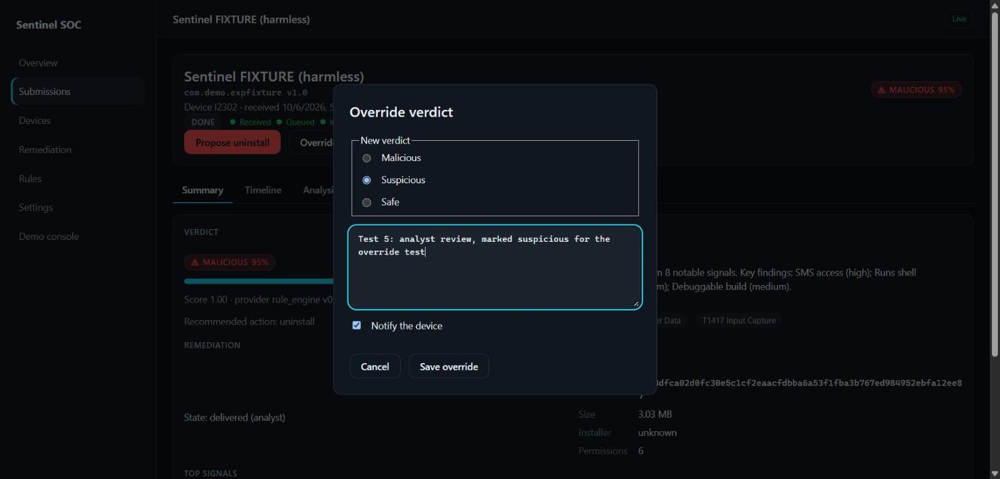
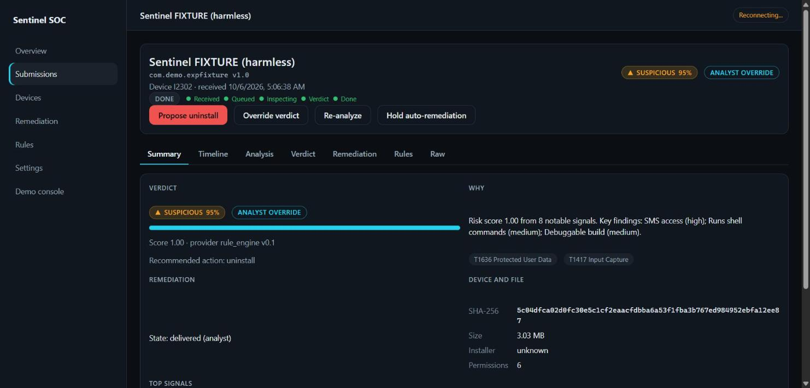

**Result: PASS**

**Note:** I chose Suspicious, not Safe. The phone only raises an alert for suspicious or malicious verdicts. A Safe override would show nothing on the phone unless "Notify on safe apps" is on.

### TC5.2: Notification on the phone

**Steps:** after saving the override, wait for the phone's command poll (about 5 seconds), then open the notification shade.

**Expected:** a notification saying the verdict changed to suspicious, with the analyst's reason.

**Actual:** the phone posted **"Suspicious app: Analyst review: suspicious."** The screenshot was taken on the phone's lock screen.

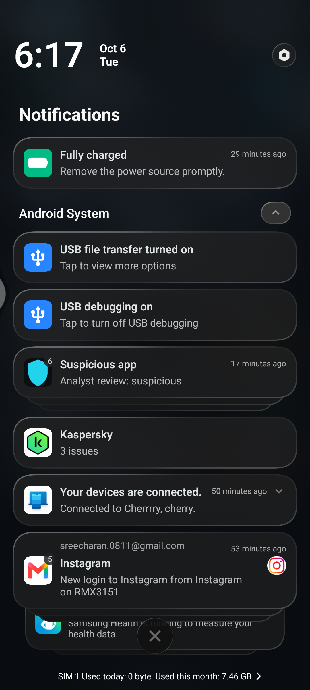

**Result: PASS**

---

## Known issues found during the run

- **Stale "Reconnecting..." badge.** The tab running the tests was in the background, so its live connection stayed down. Foreground tabs connect normally.
- **Rules tab can show stale data** after a rule is generated, until the page is reloaded (see TC3).
- **Phone screen locks** during the run. The notification was still captured from the lock screen.
